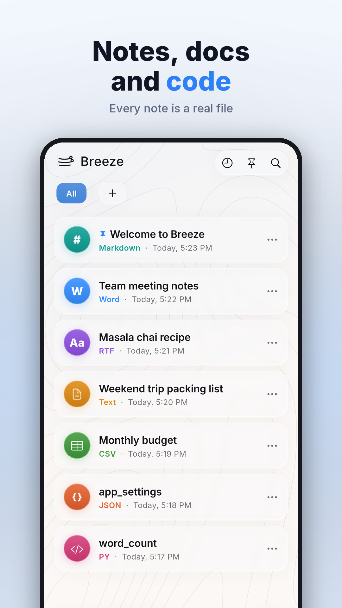
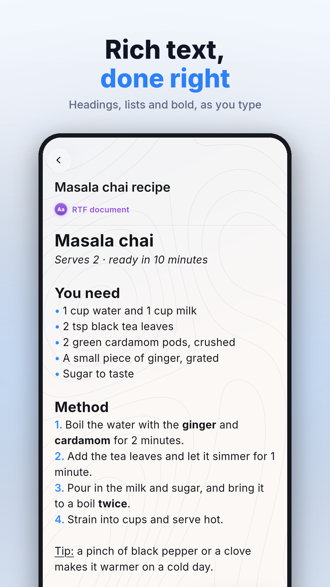
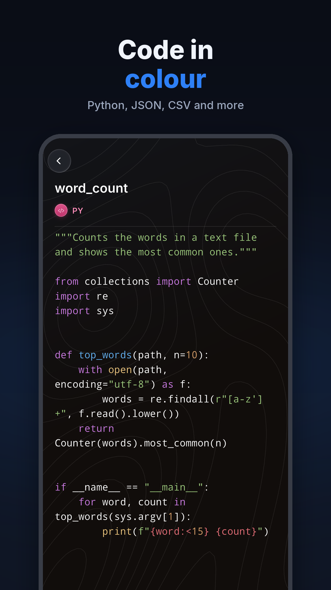
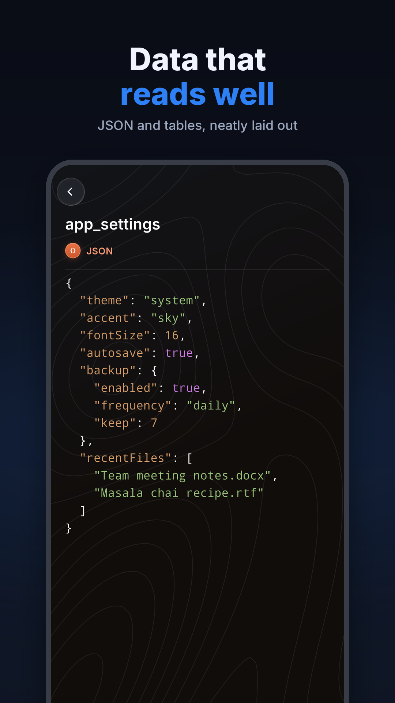
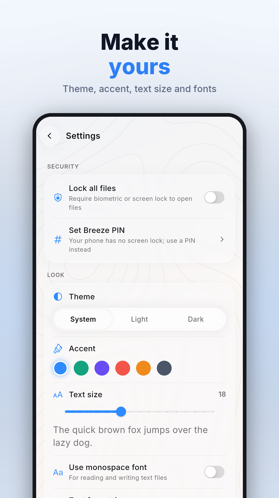
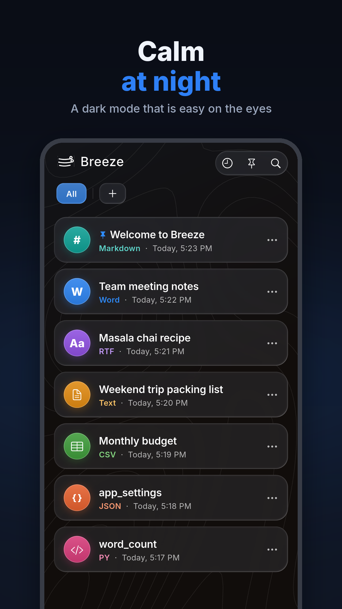
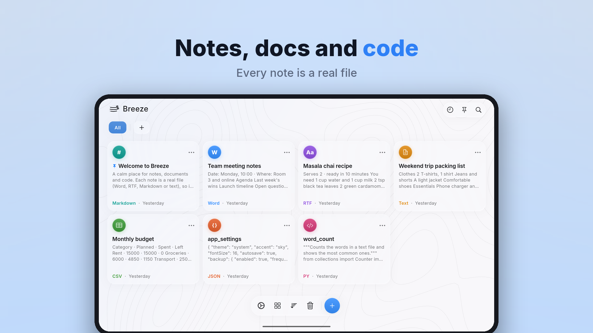
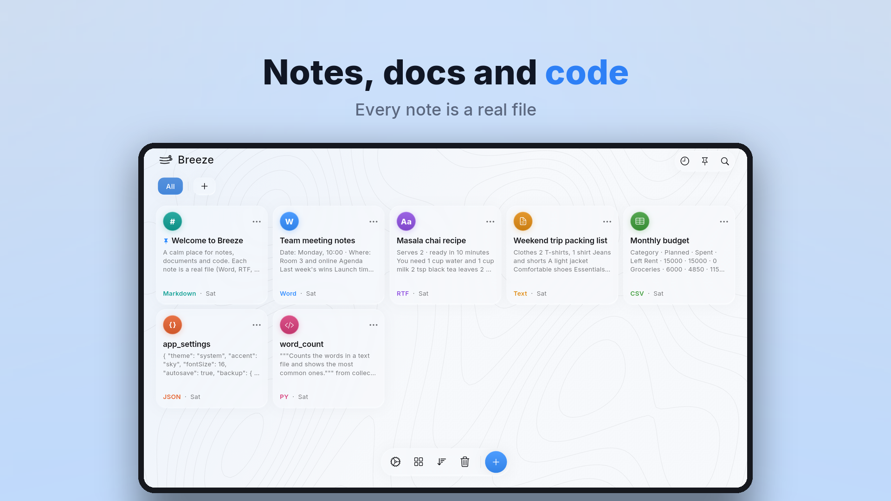

# Breeze

A fast, calm editor for Android for notes, documents and code. Every note is a real file: Markdown, Word, RTF, text, CSV, JSON or source code. No ads, no account.

<p>



</p>
<p>



</p>





## Download

Get the latest APK from [Releases](https://github.com/GagandeipSingh/breeze/releases/latest). Most phones use the **arm64-v8a** file. Requires Android 7.0 or newer.

## Features

- **Real files:** Markdown, Word (.docx), RTF, plain text, CSV, JSON and code, all kept as files
- **Rich text:** headings, lists, bold and italic as you type
- **Code in colour:** syntax highlighting for Python, JSON and more
- **Find anything:** search, pins, tags and recent files
- **Your view:** compact, standard, detailed or grid
- **Safe:** autosave, a trash that keeps files for 30 days, and an optional lock with biometrics or a Breeze PIN
- **Make it yours:** light and dark theme, six accents, text size and a monospace font
- **Any screen:** phones, tablets, foldables and desktop mode

## Build

```
flutter pub get
flutter run
```

Release builds read signing details from `android/key.properties`, which is not in this repo. Without it, release builds fall back to the debug key.

## Privacy

Breeze collects no data. Your files stay on your device. The only permission is biometrics, used only if you turn on the lock.
